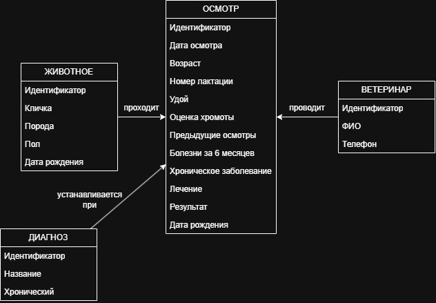
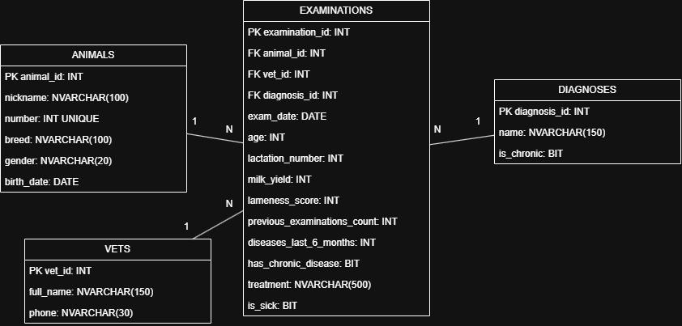

# vet-clinic - система учета ветеринарных осмотров
Информационная система для учета животных и ветеринарных осмотров с модулем прогнозирования риска заболеваний.

**Автор:** Гришин Артем Витальевич

## Описание проекта
Информационная система предназначена для учёта ветеринарных осмотров животных и последующего прогнозирования риска заболеваний.<br>
Система хранит информацию о животных, ветеринарах, диагнозах и результатах ветеринарных осмотров. На основе накопленной истории осмотров в дальнейшем планируется реализовать модуль машинного обучения для прогнозирования риска заболевания животного.

## Цель проекта
Разработать информационную систему, которая позволяет:
<ul>
<li>хранить данные о животных и историю ветеринарных осмотров;</li>
<li>учитывать ветеринаров и диагнозы;</li>
<li>анализировать историю состояния животных;</li>
<li>прогнозировать риск заболевания животного на ближайший период.</li>
</ul>

## Технологии
- **Python** — язык программирования
- **SQL Server** — хранение данных
- **pandas, numpy** — обработка данных
- **scikit-learn, LightGBM** — модели машинного обучения
- **Streamlit** — интерфейс пользователя
- **matplotlib, plotly** — визуализация
- **Git, GitHub** — версионирование


## Структура репозитория

- `docs/` — документация (ТЗ)
- `data/` — данные (CSV)
- `src/` — исходный код
- `bd/` — база данных
- `models/` — обученные модели
- `README.md` — этот файл


# 1. Сбор и подготовка данных

Для разработки используется синтетический набор данных.<br>
Сгенерированы данные:<br>
- **100 животных**;
- **500 ветеринарных осмотров**;
- **10 ветеринаров**;
- **21 диагноз**.
Данные об осмотрах имеют временную структуру. Для каждого животного существует последовательность осмотров, расположенных в хронологическом порядке.

В данных учитываются:
- возраст животного;
- номер лактации;
- удой;
- оценка хромоты;
- количество предыдущих осмотров;
- количество заболеваний за последние 6 месяцев;
- наличие хронического заболевания;
- дата осмотра;
- диагноз;
- результат осмотра.

Генерация данных выполняется с помощью:

[src/generate.py](src/generate.py)

Сгенерированные данные находятся в папке `data/`:

- [`animals.csv`](data/animals.csv)
- [`examinations.csv`](data/examinations.csv)
- [`vets.csv`](data/vets.csv)
- [`diagnoses.csv`](data/diagnoses.csv)

# 2. Проектирование базы данных

Для хранения информации разработана реляционная база данных **VetClinic** на Microsoft SQL Server.

База данных состоит из четырёх основных таблиц:

- `animals` — информация о животных;
- `vets` — информация о ветеринарах;
- `diagnoses` — справочник диагнозов;
- `examinations` — информация о ветеринарных осмотрах.

## 2.1. Инфологическая модель

Инфологическая модель описывает основные сущности предметной области и связи между ними.



## 2.2. Даталогическая модель

Даталогическая модель описывает структуру таблиц базы данных, их поля, ключи и связи.



## 2.3. SQL-схема базы данных

SQL-код создания базы данных и таблиц находится в файле:

[Открыть schema.sql](bd/schema.sql)

В базе данных используются следующие связи:

- `animals` → `examinations` — 1:N;
- `vets` → `examinations` — 1:N;
- `diagnoses` → `examinations` — 1:N.


# 3. Временная структура данных

Данные об осмотрах формируются с учётом времени.

Для каждого животного осмотры расположены в хронологическом порядке. Это позволяет использовать историю предыдущих осмотров при построении модели прогнозирования.

Планируемый принцип работы модели:

**прошлые данные → обучение → прогноз следующего периода → сравнение с фактическим результатом → переобучение модели**

Такой подход позволяет моделировать ситуацию, когда при прогнозировании модель использует только информацию, которая была доступна на соответствующий момент времени.


# 4. Машинное обучение

На следующем этапе проекта планируется разработать модель прогнозирования риска заболевания животного.

Планируемые этапы:

1. подготовка данных;
2. формирование признаков;
3. разделение данных по времени;
4. обучение базовой модели;
5. прогнозирование следующего временного периода;
6. сравнение прогноза с фактическими результатами;
7. переобучение модели с учётом новых данных;
8. оценка качества модели.

Для оценки качества модели планируется использовать:

- Accuracy;
- Precision;
- Recall;
- F1-score;
- ROC-AUC.


# 5. Пользовательский интерфейс

На следующем этапе планируется разработать пользовательский интерфейс с использованием Streamlit.

Планируемые возможности:

- просмотр информации о животных;
- просмотр истории ветеринарных осмотров;
- отображение результатов прогнозирования;
- отображение вероятности заболевания;
- выделение животных с повышенным риском.


# 6. Структура проекта

```text
vet-clinic/
│
├── data/
│   ├── animals.csv
│   ├── diagnoses.csv
│   ├── examinations.csv
│   └── vets.csv
│
├── db/
│   ├── schema.sql
│   ├── infological_model.png
│   └── datalogical_model.png
│
├── docs/
│
├── src/
│   └── generate.py
│
└── README.md
