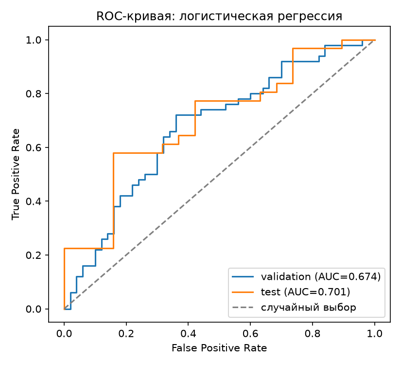
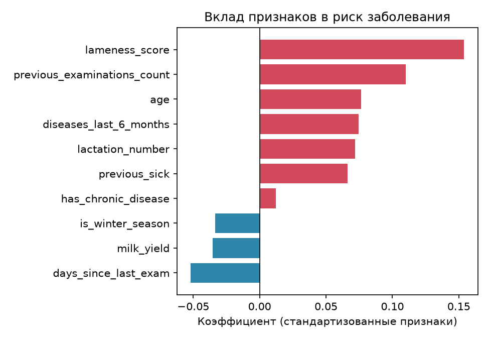

# vet-clinic - система учета ветеринарных осмотров
Информационная система для учета животных и ветеринарных осмотров с модулем прогнозирования риска заболеваний.

**Автор:** Гришин Артем Витальевич

## Описание проекта
Информационная система предназначена для учёта ветеринарных осмотров животных и последующего прогнозирования риска заболеваний.<br>
Система хранит информацию о животных, ветеринарах, диагнозах и результатах ветеринарных осмотров. На основе накопленной истории осмотров в дальнейшем планируется реализовать модуль машинного обучения для прогнозирования риска заболевания животного.

## Цель проекта
Разработать информационную систему, которая позволяет:
<ul>
<li>хранить данные о животных и историю ветеринарных осмотров;</li>
<li>учитывать ветеринаров и диагнозы;</li>
<li>анализировать историю состояния животных;</li>
<li>прогнозировать риск заболевания животного на ближайший период.</li>
</ul>

## Технологии
- **Python** — язык программирования
- **SQL Server** — хранение данных
- **pandas, numpy** — обработка данных
- **scikit-learn, LightGBM** — модели машинного обучения
- **Streamlit** — интерфейс пользователя
- **matplotlib, plotly** — визуализация
- **Git, GitHub** — версионирование


## Структура репозитория

- `docs/` — документация (ТЗ)
- `data/` — данные (CSV)
- `src/` — исходный код
- `bd/` — база данных
- `models/` — обученные модели
- `README.md` — этот файл


# 1. Сбор и подготовка данных

Для разработки используется синтетический набор данных.<br>
Сгенерированы данные:<br>
- **100 животных**;
- **500 ветеринарных осмотров**;
- **10 ветеринаров**;
- **21 диагноз**.
Данные об осмотрах имеют временную структуру. Для каждого животного существует последовательность осмотров, расположенных в хронологическом порядке.

В данных учитываются:
- возраст животного;
- номер лактации;
- удой;
- оценка хромоты;
- количество предыдущих осмотров;
- количество заболеваний за последние 6 месяцев;
- наличие хронического заболевания;
- дата осмотра;
- диагноз;
- результат осмотра.

Генерация данных выполняется с помощью:

[src/generate.py](src/generate.py)

Сгенерированные данные находятся в папке `data/`:

- [`animals.csv`](data/animals.csv)
- [`examinations.csv`](data/examinations.csv)
- [`vets.csv`](data/vets.csv)
- [`diagnoses.csv`](data/diagnoses.csv)

# 2. Проектирование базы данных

Для хранения информации разработана реляционная база данных **VetClinic** на Microsoft SQL Server.

База данных состоит из четырёх основных таблиц:

- `animals` — информация о животных;
- `vets` — информация о ветеринарах;
- `diagnoses` — справочник диагнозов;
- `examinations` — информация о ветеринарных осмотрах.

## 2.1. Инфологическая модель

Инфологическая модель описывает основные сущности предметной области и связи между ними.


## 2.2. Даталогическая модель

Даталогическая модель описывает структуру таблиц базы данных, их поля, ключи и связи.


## 2.3. SQL-схема базы данных

SQL-код создания базы данных и таблиц находится в файле:

[Открыть schema.sql](bd/schema.sql)

В базе данных используются следующие связи:

- `animals` → `examinations` — 1:N;
- `vets` → `examinations` — 1:N;
- `diagnoses` → `examinations` — 1:N.


# 3. Временная структура данных

Данные об осмотрах формируются с учётом времени.

Для каждого животного осмотры расположены в хронологическом порядке. Это позволяет использовать историю предыдущих осмотров при построении модели прогнозирования.

Планируемый принцип работы модели:

**прошлые данные - обучение - прогноз следующего периода - сравнение с фактическим результатом - переобучение модели**

Такой подход позволяет моделировать ситуацию, когда при прогнозировании модель использует только информацию, которая была доступна на соответствующий момент времени.


# 4. Машинное обучение

Задача модели — по истории осмотров животного оценить вероятность того, что на следующем осмотре у него будет выявлено заболевание (0–1). Если вероятность не ниже порога 0.6, животное считается животным с **высоким риском**. Модель не ставит диагноз и не заменяет ветеринара.

Этапы:

1. подготовка данных — **выполнено**;
2. формирование признаков — **выполнено**;
3. разделение данных по времени — **выполнено**;
4. обучение базовой модели (логистическая регрессия) — **выполнено**, см. раздел 4.1;
5. прогнозирование следующего временного периода — планируется;
6. сравнение прогноза с фактическими результатами — планируется;
7. переобучение модели с учётом новых данных — планируется;
8. оценка качества модели — для базовой модели **выполнено**, для основной (LightGBM) планируется.

Для оценки качества используются:

- Accuracy — доля верных ответов;
- Precision — из животных, названных больными, доля действительно больных;
- Recall — из действительно больных доля найденных моделью;
- F1-score — совместная оценка Precision и Recall;
- ROC-AUC — насколько хорошо модель ставит больных выше здоровых (0.5 — как случайный выбор, 1.0 — идеально).

## 4.1. Базовая модель: логистическая регрессия

Код: [src/train_baseline.py](src/train_baseline.py).

**Признаки**:

| Признак | Смысл |
|---|---|
| `age` | возраст животного, лет |
| `lactation_number` | номер лактации |
| `milk_yield` | удой |
| `lameness_score` | балл хромоты (0–5) |
| `previous_examinations_count` | сколько осмотров было до этого |
| `diseases_last_6_months` | сколько болезней за последние 6 месяцев |
| `has_chronic_disease` | есть ли хроническое заболевание |
| `previous_sick` | болело ли животное на прошлом осмотре |
| `days_since_last_exam` | дней с прошлого осмотра |
| `is_winter_season` | зимний или переходный сезон (месяцы 11, 12, 1, 2, 3) |

Последние три признака рассчитываются в скрипте по истории осмотров животного, остальные берутся из `examinations.csv`. Диагноз (`diagnosis_id`) и лечение (`treatment`) в признаки **не входят**: они известны только после осмотра, и с ними модель «списывала бы ответ» (утечка цели).

**Разделение 70/20/10 — по времени**, а не случайно: самые ранние осмотры идут в обучение, более поздние — в валидацию и тест. Так модель не «подглядывает» в будущее.

| Выборка | Осмотров | Период | Доля больных |
|---|---|---|---|
| train (обучение) | 350 | 2023-01-02 — 2024-11-25 | 0.511 |
| validation (подбор параметров) | 100 | 2024-11-26 — 2025-06-11 | 0.500 |
| test (финальная проверка) | 50 | 2025-06-13 — 2025-10-01 | 0.620 |

Перед обучением признаки приводятся к одному масштабу (`StandardScaler`). Параметр регуляризации `C` перебирается по списку и выбирается по ROC-AUC на валидации (лучшее значение — `C = 0.01`). Тестовая выборка используется один раз, для финальной оценки.

**Метрики.** Показаны два порога: стандартный 0.5 и порог «высокого риска» 0.6 из ТЗ.

| Выборка | Порог | Accuracy | Precision | Recall | F1 | ROC-AUC |
|---|---|---|---|---|---|---|
| train | 0.5 | 0.574 | 0.587 | 0.564 | 0.575 | 0.647 |
| train | 0.6 | 0.583 | 0.770 | 0.263 | 0.392 | 0.647 |
| validation | 0.5 | 0.590 | 0.565 | 0.780 | 0.655 | 0.674 |
| validation | 0.6 | 0.610 | 0.704 | 0.380 | 0.494 | 0.674 |
| **test** | 0.5 | 0.700 | 0.682 | 0.968 | 0.800 | 0.701 |
| **test** | 0.6 | 0.640 | 0.760 | 0.613 | 0.679 | 0.701 |

Результаты сохраняются в папку [models/](models/): модель `baseline_logreg.joblib`, метрики `metrics_baseline.json` и два графика.

| ROC-кривая | Вклад признаков |
|---|---|
|  |  |

В графике вклада признаков красным показаны признаки, повышающие риск, синим — понижающие. Сильнее всего риск повышают хромота (`lameness_score`), число предыдущих осмотров и возраст.

**Выводы и ограничения.**

- Качество умеренное: ROC-AUC 0.67 на валидации и 0.70 на тесте. Для сравнения, 0.5 — это случайное угадывание.
- При пороге 0.5 на тесте модель назвала больными 44 из 50 осмотров (Recall 0.968, но 14 ложных тревог). В тесте больных 62%, поэтому ответ «болен всегда» дал бы Accuracy 0.62. Модель при этом пороге лишь немного лучше, и Accuracy 0.70 не стоит считать высоким результатом.
- При пороге 0.6 на валидации модель находит только 38% больных (Recall 0.380), зато Precision выше (0.704). Порог 0.6 надёжнее в том, что отмеченные животные действительно чаще больны, но он пропускает многих больных. Порог нужно обсудить и, возможно, подобрать по цели.
- Тест содержит всего 50 осмотров, поэтому метрики на нём неустойчивы: ошибка в одном осмотре сдвигает Accuracy на 2 п.п. Ориентироваться надёжнее на валидацию и ROC-AUC.
- Низкое качество связано в первую очередь с данными, а не с моделью: данные синтетические, и в генераторе заболевание определяется вероятностью с большой долей случайности. Даже «идеальная» вероятность, по которой генератор строил `is_sick`, даёт ROC-AUC лишь ≈ 0.66 на всём датасете. Основная модель (LightGBM) вряд ли заметно превзойдёт базовую на этих данных.

# 5. Пользовательский интерфейс

На следующем этапе планируется разработать пользовательский интерфейс с использованием Streamlit.

Планируемые возможности:

- просмотр информации о животных;
- просмотр истории ветеринарных осмотров;
- отображение результатов прогнозирования;
- отображение вероятности заболевания;
- выделение животных с повышенным риском.


# 6. Структура проекта

```text
vet-clinic/
│
├── data/
│   ├── animals.csv
│   ├── diagnoses.csv
│   ├── examinations.csv
│   └── vets.csv
│
├── bd/
│   ├── schema.sql
│   ├── infolog_diagram.jpg
│   └── datalog.jpg
│
├── docs/
│   └── ТЗ_шаблон_проектная_работа.docx
│
├── models/
│   ├── baseline_logreg.joblib
│   ├── metrics_baseline.json
│   ├── roc_baseline.png
│   └── feature_importance_baseline.png
│
├── src/
│   ├── generate.py
│   └── train_baseline.py
│
└── README.md
```

# 7. Статус проекта

Прогресс относительно графика чекпоинтов из ТЗ:

| Чекпоинт | Что показывается | Статус |
|---|---|---|
| 1 (недели 1–2) | Постановка задачи, предметная область, стек | выполнено |
| 2 (недели 3–4) | Сбор и подготовка данных, прототип хранения | выполнено: генератор, CSV, схема БД |
| 3 (недели 5–6) | Первая версия алгоритма, разделение 70/20/10, первые метрики | выполнено: логистическая регрессия, метрики, графики |
| 4 (недели 7–8) | Интеграция модели с БД, LightGBM, финальные метрики на тесте | в планах |
| 5 (недели 9–10) | Интерфейс Streamlit, визуализация | в планах |
| 6–8 (недели 11–16) | Тестирование, документация, защита | в планах |

Ближайшие шаги: загрузка данных в SQL Server, основная модель на LightGBM и сравнение её метрик с базовой, затем интерфейс на Streamlit.
