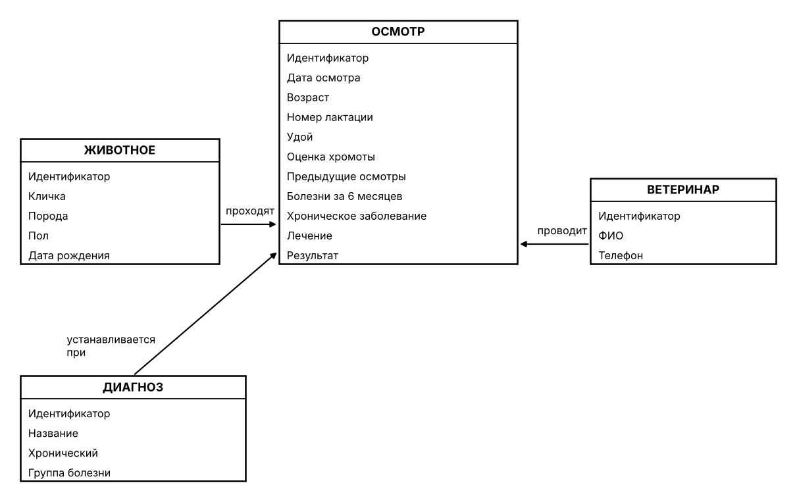
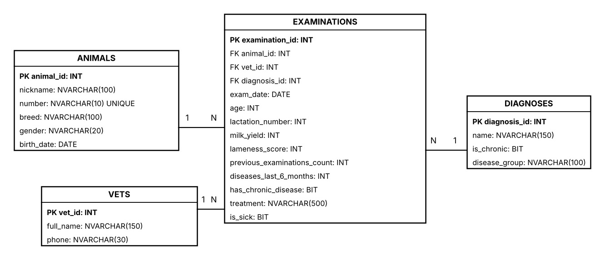
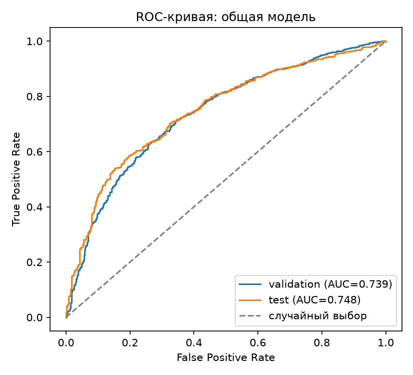
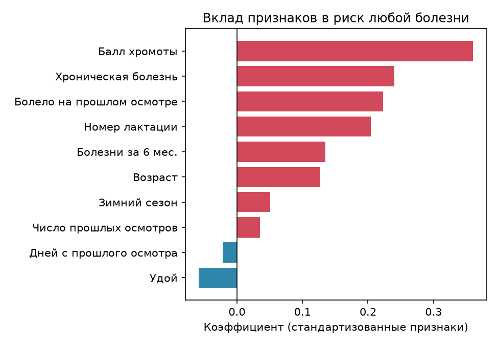
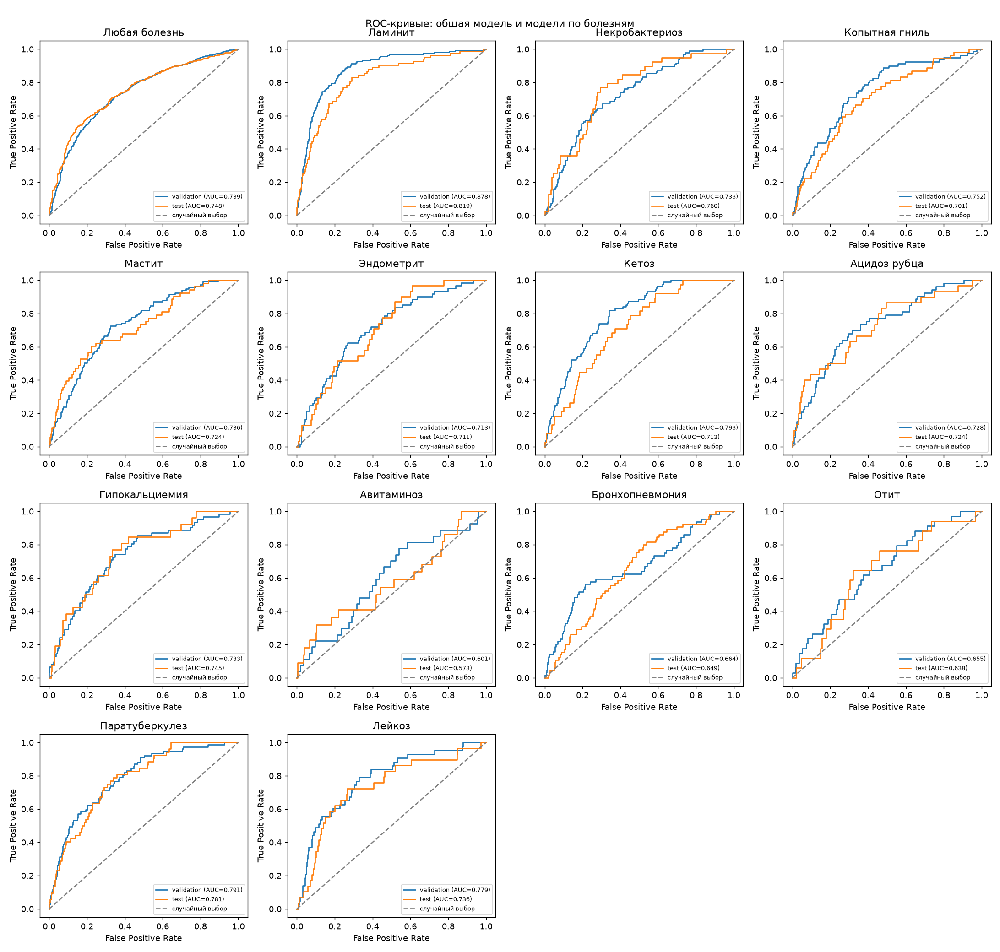
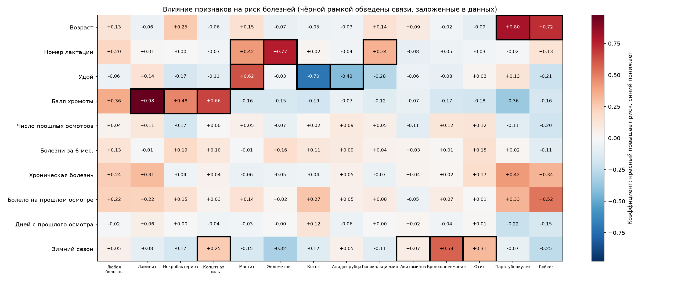
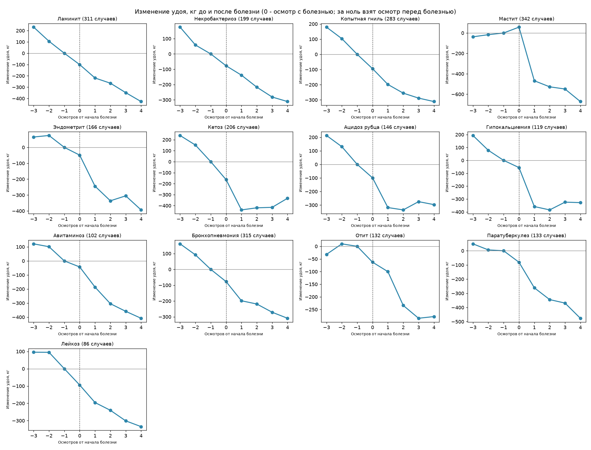

# vet-clinic - система учета ветеринарных осмотров
Информационная система для учета животных и ветеринарных осмотров с модулем прогнозирования риска заболеваний.

**Автор:** Гришин Артем Витальевич

## Описание проекта
Информационная система предназначена для учёта ветеринарных осмотров молочных коров и прогнозирования риска заболеваний.<br>
Система хранит информацию о животных, ветеринарах, диагнозах и результатах ветеринарных осмотров. На основе накопленной истории осмотров модуль машинного обучения оценивает риск заболевания: общий и по каждой конкретной болезни (мастит, кетоз, ламинит и т.д.).

## Цель проекта
Разработать информационную систему, которая позволяет:
<ul>
<li>хранить данные о животных и историю ветеринарных осмотров;</li>
<li>учитывать ветеринаров и диагнозы;</li>
<li>анализировать историю состояния животных;</li>
<li>прогнозировать риск заболевания животного и риск конкретной болезни на ближайший период.</li>
</ul>

## Технологии
- **Python** — язык программирования
- **SQL Server** — хранение данных
- **pandas, numpy** — обработка данных
- **scikit-learn** — модели машинного обучения (логистическая регрессия)
- **Streamlit** — интерфейс пользователя (планируется)
- **matplotlib** — визуализация
- **Git, GitHub** — версионирование


## Структура репозитория

- `docs/` — документация (ТЗ)
- `data/` — данные (CSV) и прогноз на 2026 год
- `src/` — исходный код
- `bd/` — база данных
- `models/` — обученные модели, метрики и графики
- `requirements.txt` — список библиотек
- `README.md` — этот файл


# 1. Сбор и подготовка данных

Для разработки используется синтетический набор данных.<br>
Сгенерированы данные:<br>
- **400 животных**;
- **10 000 ветеринарных осмотров** (в среднем 25 на животное, период 2023-01-01 — 2025-12-31);
- **10 ветеринаров**;
- **21 диагноз** (20 болезней и «Здоров»), болезни объединены в 5 групп (копыта и конечности; вымя и размножение; обмен веществ и пищеварение; органы дыхания и чувств; инфекции и паразиты).

Данные об осмотрах имеют временную структуру. Для каждого животного существует последовательность осмотров, расположенных в хронологическом порядке.

В данных учитываются:
- возраст животного;
- номер лактации;
- удой;
- оценка хромоты;
- количество предыдущих осмотров;
- количество заболеваний за последние 6 месяцев;
- наличие хронического заболевания;
- дата осмотра;
- диагноз;
- результат осмотра.

**Важно: данные синтетические.** Связи «признак - конкретная болезнь» заданы в генераторе вручную по ветеринарной логике (таблица `DISEASE_RULES` в [src/generate.py](src/generate.py)): например, хромота повышает вероятность ламинита, высокий удой и число лактаций — мастита, зима — бронхопневмонии, возраст — лейкоза. Модель машинного обучения затем проверяет, способна ли она восстановить эти связи по данным. Это проверка работы пайплайна, а не открытие закономерностей на реальных данных. Генератор использует фиксированный seed, поэтому каждый запуск создаёт одинаковые данные.

Генерация данных выполняется с помощью:

[src/generate.py](src/generate.py)

Сгенерированные данные находятся в папке `data/`:

- [`animals.csv`](data/animals.csv)
- [`examinations.csv`](data/examinations.csv)
- [`vets.csv`](data/vets.csv)
- [`diagnoses.csv`](data/diagnoses.csv)

# 2. Проектирование базы данных

Для хранения информации разработана реляционная база данных **VetClinic** на Microsoft SQL Server.

База данных состоит из четырёх основных таблиц:

- `animals` — информация о животных;
- `vets` — информация о ветеринарах;
- `diagnoses` — справочник диагнозов (название, хроническая ли болезнь, группа болезни `disease_group`);
- `examinations` — информация о ветеринарных осмотрах.

## 2.1. Инфологическая модель

Инфологическая модель описывает основные сущности предметной области и связи между ними.



## 2.2. Даталогическая модель

Даталогическая модель описывает структуру таблиц базы данных, их поля, ключи и связи.



## 2.3. SQL-схема базы данных

SQL-код создания базы данных и таблиц находится в файле:

[Открыть schema.sql](bd/schema.sql)

В базе данных используются следующие связи:

- `animals` - `examinations` — 1:N;
- `vets` - `examinations` — 1:N;
- `diagnoses` - `examinations` — 1:N.


# 3. Временная структура данных

Данные об осмотрах формируются с учётом времени.

Для каждого животного осмотры расположены в хронологическом порядке. Это позволяет использовать историю предыдущих осмотров при построении модели прогнозирования.

Принцип работы модели:

**прошлые данные - обучение - проверка на более поздних данных - прогноз следующего периода (2026 год)**

Такой подход позволяет моделировать ситуацию, когда при прогнозировании модель использует только информацию, которая была доступна на соответствующий момент времени.


# 4. Машинное обучение

Модель решает две задачи:

1. **Общий риск:** по истории осмотров животного оценивает вероятность (0–1), что на осмотре будет выявлено заболевание. Если вероятность не ниже порога 0.6 (из ТЗ), животное считается животным с **высоким риском**.
2. **Риск конкретной болезни:** для каждой достаточно частой болезни своя модель оценивает вероятность, что у животного будет выявлена именно эта болезнь.

Модель не ставит диагноз и не заменяет ветеринара: она помогает выбрать, каких животных осмотреть в первую очередь.

Этапы:

1. подготовка данных — **выполнено**;
2. формирование признаков — **выполнено**;
3. разделение данных по времени (70/20/10) — **выполнено**;
4. обучение общей модели и моделей по болезням (логистическая регрессия) — **выполнено**;
5. оценка качества на тестовой выборке — **выполнено**;
6. анализ влияния признаков на разные болезни — **выполнено**;
7. прогноз на 2026 год — **выполнено**;
8. сравнение с другим алгоритмом, интеграция с БД — планируется.

Для оценки качества используются:

- Accuracy — доля верных ответов;
- Precision — из животных, названных больными, доля действительно больных;
- Recall — из действительно больных доля найденных моделью;
- F1-score — совместная оценка Precision и Recall;
- ROC-AUC — насколько хорошо модель ставит больных выше здоровых (0.5 — как случайный выбор, 1.0 — идеально).

Код: [src/train_baseline.py](src/train_baseline.py).

## 4.1. Признаки

| Признак | Смысл |
|---|---|
| `age` | возраст животного, лет |
| `lactation_number` | номер лактации |
| `milk_yield` | удой |
| `lameness_score` | балл хромоты |
| `previous_examinations_count` | сколько осмотров было до этого |
| `diseases_last_6_months` | сколько болезней за последние 6 месяцев |
| `has_chronic_disease` | есть ли хроническое заболевание |
| `previous_sick` | болело ли животное на прошлом осмотре |
| `days_since_last_exam` | дней с прошлого осмотра |
| `is_winter_season` | зимний или переходный сезон (месяцы 11, 12, 1, 2, 3) |

Последние три признака рассчитываются в скрипте по истории осмотров животного, остальные берутся из `examinations.csv`. Диагноз, название болезни и лечение в признаки **не входят**: они известны только после осмотра, и с ними модель «списывала бы ответ» (утечка цели).

## 4.2. Разделение данных

**Разделение 70/20/10 — по времени**, а не случайно: самые ранние осмотры идут в обучение, более поздние — в валидацию и тест. Так модель не «подглядывает» в будущее.

| Выборка | Осмотров | Период | Доля больных |
|---|---|---|---|
| train (обучение) | 7000 | 2023-01-01 — 2025-02-09 | 43.0 % |
| validation (подбор параметров) | 2000 | 2025-02-09 — 2025-09-09 | 53.2 % |
| test (финальная проверка) | 1000 | 2025-09-09 — 2025-12-31 | 60.0 % |

Перед обучением признаки приводятся к одному масштабу (`StandardScaler`). Параметр регуляризации `C` перебирается по списку и выбирается по ROC-AUC на валидации. Тестовая выборка используется один раз, для финальной оценки.

## 4.3. Общая модель: болезнь да/нет

Показаны два порога: стандартный 0.5 и порог «высокого риска» 0.6 из ТЗ.

| Выборка | Порог | Accuracy | Precision | Recall | F1 | ROC-AUC |
|---|---|---|---|---|---|---|
| train | 0.5 | 0.691 | 0.693 | 0.503 | 0.583 | 0.723 |
| train | 0.6 | 0.680 | 0.759 | 0.375 | 0.502 | 0.723 |
| validation | 0.5 | 0.683 | 0.694 | 0.727 | 0.710 | 0.739 |
| validation | 0.6 | 0.673 | 0.749 | 0.580 | 0.654 | 0.739 |
| **test** | 0.5 | 0.689 | 0.731 | 0.762 | 0.746 | 0.748 |
| **test** | 0.6 | 0.671 | 0.768 | 0.647 | 0.702 | 0.748 |

| ROC-кривая | Вклад признаков |
|---|---|
|  |  |

## 4.4. Модели по конкретным болезням

Для каждой болезни, по которой в данных не менее 150 случаев, обучена отдельная модель (13 болезней): «будет ли на осмотре выявлена именно эта болезнь». Для 7 редких болезней (тимпания рубца, травматический ретикулит, конъюнктивит, пироплазмоз, туберкулёз, бруцеллёз, ящур; от 13 до 116 случаев) модели не строятся: данных слишком мало, чтобы честно оценить качество.

Порог высокого риска для болезни выбран по максимуму F1 на валидации (болезни редкие, при пороге 0.6 почти ни одно животное не попало бы в «высокий риск»).

| Болезнь | Случаев всего | Случаев в тесте | Порог | ROC-AUC (вал.) | ROC-AUC (тест) | Precision | Recall | F1 |
|---|---|---|---|---|---|---|---|---|
| Ламинит | 695 | 83 | 0.29 | 0.878 | **0.819** | 0.322 | 0.470 | 0.382 |
| Паратуберкулёз | 291 | 52 | 0.12 | 0.791 | **0.781** | 0.205 | 0.346 | 0.257 |
| Некробактериоз | 319 | 39 | 0.05 | 0.733 | **0.760** | 0.082 | 0.359 | 0.133 |
| Гипокальциемия | 178 | 26 | 0.05 | 0.733 | **0.745** | 0.119 | 0.192 | 0.147 |
| Лейкоз | 167 | 29 | 0.06 | 0.779 | **0.736** | 0.089 | 0.310 | 0.138 |
| Мастит | 521 | 53 | 0.09 | 0.736 | **0.724** | 0.150 | 0.491 | 0.230 |
| Ацидоз рубца | 216 | 30 | 0.06 | 0.728 | **0.724** | 0.167 | 0.367 | 0.229 |
| Кетоз | 315 | 38 | 0.09 | 0.793 | **0.713** | 0.080 | 0.237 | 0.119 |
| Эндометрит | 241 | 31 | 0.08 | 0.713 | **0.711** | 0.107 | 0.097 | 0.102 |
| Копытная гниль | 433 | 54 | 0.13 | 0.752 | **0.701** | 0.119 | 0.259 | 0.163 |
| Бронхопневмония | 481 | 65 | 0.08 | 0.664 | **0.649** | 0.096 | 0.723 | 0.169 |
| Отит | 178 | 17 | 0.05 | 0.655 | **0.638** | 0.023 | 0.059 | 0.033 |
| Авитаминоз | 156 | 22 | 0.05 | 0.601 | **0.573** | 0.000 | 0.000 | 0.000 |

ROC-кривые общей модели и каждой болезни:



## 4.5. Влияние признаков на разные болезни

Коэффициенты логистической регрессии считаются на стандартизованных признаках, поэтому их можно сравнивать между собой. Красный цвет — признак повышает риск болезни, синий — понижает. Чёрной рамкой обведены связи, заложенные в генераторе.



Модель нашла **все 15 заложенных связей**:

| Болезнь | Что повышает риск | Что понижает |
|---|---|---|
| Ламинит, некробактериоз, копытная гниль | хромота (гниль — ещё зима) | |
| Мастит | высокий удой, больше лактаций | |
| Эндометрит, гипокальциемия | больше лактаций | |
| Кетоз, ацидоз рубца | | высокий удой |
| Авитаминоз, бронхопневмония, отит | зима | |
| Паратуберкулёз, лейкоз | возраст | |

Слабое место: влияние зимы на авитаминоз модель почти не видит (коэффициент +0.07), ROC-AUC этой болезни всего 0.57. Остальные коэффициенты — в [models/feature_effects.csv](models/feature_effects.csv), столбчатые графики по каждой болезни — в `models/feature_effects_diseases.png`.

## 4.6. Динамика: как болезнь меняет удой и хромоту

В генераторе после болезни удой падает по-разному: сильнее всего после мастита, кетоза и гипокальциемии, слабее после болезней копыт и дыхания; болезни копыт усиливают хромоту. Средний удой через один осмотр после начала болезни снижается: мастит −468 кг, кетоз −439, гипокальциемия −358, ацидоз −318, паратуберкулёз −261, эндометрит −244, ламинит −219, копытная гниль −198, некробактериоз −139, отит −100.

Графики строит [src/plot_dynamics.py](src/plot_dynamics.py): `models/dynamics_milk_by_disease.png`, `models/dynamics_lameness_by_disease.png` (изменение за 3 осмотра до и 4 после начала болезни) и `models/dynamics_cow_examples.png` (удой отдельных коров с отметками болезней).



Замечание: удой снижается и до начала болезни, потому что корова часто уже болела другой болезнью.

## 4.7. Прогноз на 2026 год

Скрипт [src/predict_2026.py](src/predict_2026.py) переобучает модели на всех данных (2023–2025) и считает риск на 01.01.2026 для каждого из 400 животных по его последнему известному осмотру. Результат — [data/predictions_2026.csv](data/predictions_2026.csv):

- `risk_probability`, `risk_level` — общий риск и уровень («Высокий» при вероятности не ниже 0.6);
- `risk_<болезнь>`, `level_<болезнь>` — риск и уровень по каждой из 13 болезней;
- `high_risk_diseases` — болезни с высоким риском у животного;
- `top_disease` — самая «подозрительная» болезнь (риск сильнее всего выше обычной частоты болезни).

Высокий общий риск у 200 животных из 400. Распределение рисков: `models/risk_distribution_2026.png`.

## 4.8. Выводы и ограничения

- Качество умеренное: общая модель ROC-AUC 0.74 на валидации и 0.75 на тесте; по болезням от 0.57 (авитаминоз) до 0.82 (ламинит).
- Болезни редкие, поэтому Precision по ним низкий (чаще 0.1–0.3). Модель лучше ранжирует животных по риску, чем «ставит диагноз», и пригодна для выбора животных на первоочередной осмотр.
- В тесте по большинству болезней всего 17–83 случая, оценки шумные. Отит и авитаминоз предсказываются почти на уровне случайного угадывания.
- Данные синтетические, связи заданы вручную, на реальных данных результаты будут другими.
- Пороги болезней подобраны на смеси сезонов, поэтому на дату прогноза (январь, зима) для бронхопневмонии высокий риск у 262 из 400 животных — это завышение.
- Семь редких болезней не моделируются.

# 5. Пользовательский интерфейс

На следующем этапе планируется разработать пользовательский интерфейс с использованием Streamlit.

Планируемые возможности:

- просмотр информации о животных;
- просмотр истории ветеринарных осмотров;
- отображение результатов прогнозирования;
- отображение вероятности заболевания и риска по каждой болезни;
- выделение животных с повышенным риском.


# 6. Как запустить

Команды выполняются из корня проекта (там, где лежат папки `src`, `data`, `models`).

```bash
python -m pip install -r requirements.txt
python src/generate.py           # данные (при одинаковом seed каждый раз одинаковые)
python src/train_baseline.py     # обучение, метрики, графики
python src/predict_2026.py       # прогноз на 2026 год
python src/plot_dynamics.py      # графики динамики удоя и хромоты
```

# 7. Структура проекта

```text
vet-clinic/
│
├── data/
│   ├── animals.csv
│   ├── diagnoses.csv
│   ├── examinations.csv
│   ├── vets.csv
│   └── predictions_2026.csv
│
├── bd/
│   ├── schema.sql
│   ├── infolog_diagram.jpg
│   └── datalog.jpg
│
├── docs/
│   └── ТЗ_шаблон_проектная_работа.docx
│
├── models/
│   ├── baseline_logreg.joblib, final_logreg.joblib      # общая модель
│   ├── disease_<код>.joblib, final_disease_<код>.joblib # модели по болезням
│   ├── metrics_baseline.json, metrics_diseases.json     # метрики
│   ├── feature_effects.csv                              # влияние признаков
│   └── *.png                                            # графики
│
├── src/
│   ├── generate.py
│   ├── train_baseline.py
│   ├── predict_2026.py
│   └── plot_dynamics.py
│
├── requirements.txt
└── README.md
```

# 8. Статус проекта


| Чекпоинт | Что показывается | Статус |
|---|---|---|
| 1 (недели 1–2) | Постановка задачи, предметная область, стек | выполнено |
| 2 (недели 3–4) | Сбор и подготовка данных, прототип хранения | выполнено: генератор, CSV, схема БД |
| 3 (недели 5–6) | Первая версия алгоритма, разделение 70/20/10, первые метрики | выполнено: логистическая регрессия, метрики, графики |
| 4 (недели 7–8) | Интеграция модели с БД, финальные метрики на тесте | частично: модели по болезням, метрики на тесте, прогноз на 2026; интеграция с БД в планах |
| 5 (недели 9–10) | Интерфейс Streamlit, визуализация | в планах |
| 6–8 (недели 11–16) | Тестирование, документация, защита | в планах |

Ближайшие шаги: интерфейс на Streamlit, загрузка данных в SQL Server.
